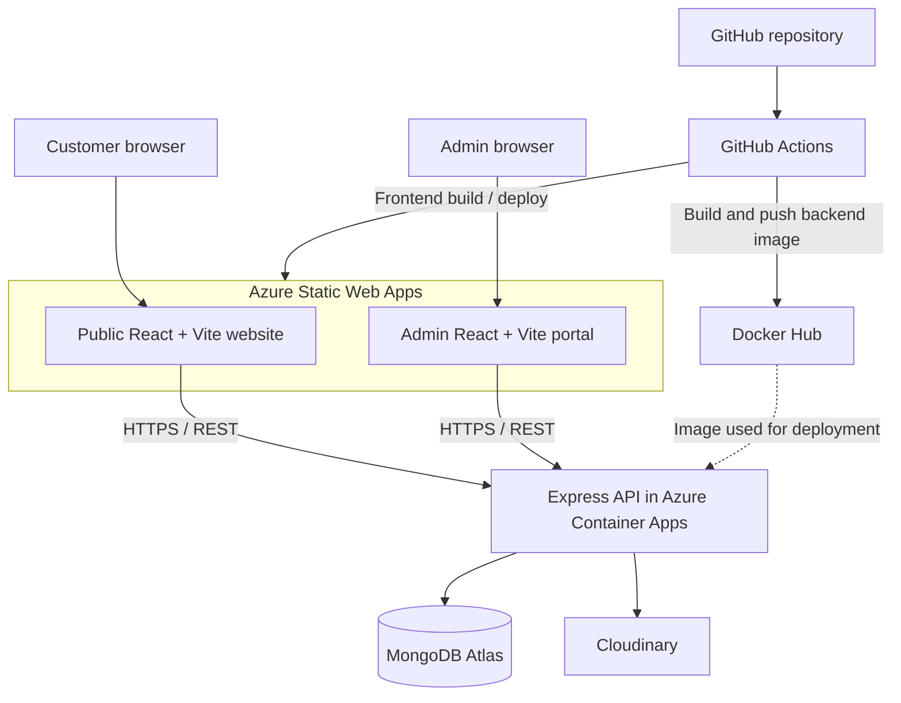

<div align="center">

# ✂️ SAM SALON

### Full-Stack Salon Booking & Management Platform

A modern customer booking experience, a dedicated administration portal, and a cloud-hosted REST API.


[Customer Website](https://www.samsalon.studio) · [Admin Portal](https://admin.samsalon.studio) · [API Health Check](https://sam-salon-api.thankfulbay-3f69159b.centralindia.azurecontainerapps.io/api/health) · [Source Code](https://github.com/sameerkhuhro/sam-salon)

</div>

---

## Contents

1. [Overview](#1-overview)
2. [Live Application](#2-live-application)
3. [Features](#3-features)
4. [Technology Stack](#4-technology-stack)
5. [System Architecture](#5-system-architecture)
6. [Repository Structure](#6-repository-structure)
7. [Getting Started Locally](#7-getting-started-locally)
8. [Environment Configuration](#8-environment-configuration)
9. [Database Environments & Seeding](#9-database-environments--seeding)
10. [Admin Account Management](#10-admin-account-management)
11. [Staff & Services Architecture](#11-staff--services-architecture)
12. [Media Uploads](#12-media-uploads)
13. [Docker & Containerization](#13-docker--containerization)
14. [Azure Deployment](#14-azure-deployment)
15. [CI/CD with GitHub Actions](#15-cicd-with-github-actions)
16. [API Reference](#16-api-reference)
17. [Testing](#17-testing)
18. [Security](#18-security)
19. [Troubleshooting](#19-troubleshooting)
20. [Project Author](#20-project-author)

---

## 1. Overview

**SAM SALON** is a full-stack unisex salon management application designed to streamline salon discovery, appointment booking, and day-to-day administration. It consists of three independently developed components:

| Component | Responsibility | Local development |
|---|---|---|
| **Public website** (`salonhub/`) | Customer-facing pages, services, staff, appointment booking | Vite (typically port `5173`) |
| **Admin portal** (`admin/`) | Appointments, services, staff, customers, payments, and business management | Vite (typically port `5174`) |
| **Backend API** (`server/`) | Business rules, authentication, booking, database access, media integrations | Express (port `5000`) |

In production, the two React frontends run on **Azure Static Web Apps**, the Dockerized Node.js API runs on **Azure Container Apps**, and **MongoDB Atlas** provides persistent storage.

---

## 2. Live Application

| Service | Production URL |
|---|---|
| Customer website | https://www.samsalon.studio |
| Root domain | https://samsalon.studio |
| Admin portal | https://admin.samsalon.studio |
| Backend health check | https://sam-salon-api.thankfulbay-3f69159b.centralindia.azurecontainerapps.io/api/health |
| GitHub repository | https://github.com/sameerkhuhro/sam-salon |

> The admin portal is intended for authorized salon administrators. The health-check endpoint shows API availability only; it is not a substitute for end-to-end monitoring.

---

## 3. Features

### Customer experience
- Responsive public website with salon information, service catalog, staff profiles, and contact pages
- Service browsing with category filters and search
- Multi-service booking with a selected-service summary and combined pricing and duration
- Staff selection and **live availability** based on opening hours, shifts, breaks, and leaves
- Customer booking details with optional email (when supported by the deployed API)
- Booking confirmation page and reference-based lookup

### Salon administration
- Protected administrator sign-in and account management
- Dashboard with operational overview and KPIs (revenue = verified payments minus refunds, 7-day trend)
- Appointment review, status changes (`confirmed`, `completed`, `cancelled`), and rescheduling
- Staff profiles, assigned services, specialties, working schedules, and leave scheduling
- Service and category management with active/inactive status and safe archival
- Customer directory with visit and spend statistics
- Payments: cash/card receipts, partial or full refunds, and an audit register
- Salon settings: address, contacts, opening hours, logo, and banner

### Engineering and operations
- REST API built with Express and Mongoose
- Double-booking and overlap prevention (conflicts return `HTTP 409`)
- JWT authentication with HttpOnly cookies and bcrypt password hashing
- Cloudinary media uploads with automatic local-disk fallback
- MongoDB Atlas persistence with separate development and production databases
- Docker image packaging and Docker Hub distribution
- Separate Azure-hosted customer and admin frontends
- GitHub Actions workflows for frontend delivery and backend image builds
- 20-point end-to-end integration test suite

---

## 4. Technology Stack

| Layer | Technologies / services |
|---|---|
| **Frontend** | React, Vite, JavaScript, HTML, CSS |
| **Backend** | Node.js, Express.js, REST API |
| **Database / ODM** | MongoDB Atlas, Mongoose |
| **Authentication** | JWT, HttpOnly cookies, bcrypt |
| **Media** | Cloudinary (local `/uploads` fallback) |
| **Containerization** | Docker, Dockerfile (Node.js Alpine), Docker Hub |
| **Cloud hosting** | Microsoft Azure Static Web Apps, Azure Container Apps |
| **CI/CD** | GitHub Actions |
| **Version control** | Git, GitHub |
| **Domain / HTTPS** | `samsalon.studio` custom domain, Azure-managed TLS for Static Web Apps |

---

## 5. System Architecture



**Request flow:** The browser loads a React frontend from Azure Static Web Apps. The frontend makes HTTPS requests to the Express service in Azure Container Apps. The API enforces business logic and reads/writes records in MongoDB Atlas. Media uploads are handled through Cloudinary.

> **Deployment note:** The backend Docker image is built and pushed by GitHub Actions, but updating the running revision in Azure Container Apps may require a separate/manual step. Do not assume it redeploys automatically after every push.

---

## 6. Repository Structure

```text
sam-salon/
├── .github/
│   └── workflows/             # GitHub Actions pipelines
├── salonhub/                  # Customer-facing React/Vite app (Port 5173)
│   ├── src/
│   │   ├── components/        # Editorial UI components, Header, Footer
│   │   ├── pages/             # Home, Services, Team, Book, Confirmation, About, Contact
│   │   └── lib/               # api.js: booking & availability client
│   └── public/
├── admin/                     # Admin React/Vite app (Port 5174)
│   ├── src/
│   │   ├── components/        # Layout (Sidebar, Header), Modals, StatCards, Badges
│   │   ├── context/           # AdminAuthContext (JWT session persistence)
│   │   ├── pages/             # Dashboard, Appointments, Staff, Services, Admins, ...
│   │   └── services/          # API client for the backend
│   └── public/
├── server/                    # Express API (Port 5000)
│   ├── src/
│   │   ├── config/            # MongoDB connection & resilient failover
│   │   ├── controllers/       # Auth, Admins, Services, Staff, Appointments, ...
│   │   ├── middleware/        # JWT auth (`protect`) & central error handler
│   │   ├── models/            # Mongoose schemas
│   │   ├── routes/            # REST routes (/api/*)
│   │   ├── seed/              # Seeder: initial admin & service catalog
│   │   └── server.js          # Express entry point
│   ├── Dockerfile
│   └── package.json
├── scratch/
│   └── verify_all.js          # 20-point end-to-end integration test
└── README.md
```

> This is a conceptual map based on the known layout. The current repository may contain additional configuration and assets.

---

## 7. Getting Started Locally

### Prerequisites

- **Node.js** 18+ and **npm**
- **Git**
- A **MongoDB Atlas** connection configured for a *development* database
- *(Optional)* **Cloudinary** credentials for cloud media uploads
- *(Optional)* **Docker** for container builds

### 1. Clone the repository

```bash
git clone https://github.com/sameerkhuhro/sam-salon.git
cd sam-salon
```

### 2. Install dependencies

```bash
cd server   && npm install && cd ..
cd salonhub && npm install && cd ..
cd admin    && npm install && cd ..
```

### 3. Configure the API

Create `server/.env` locally using the [Environment Configuration](#8-environment-configuration) section. **Do not copy production secrets** into a public repository.

### 4. Start the backend (Terminal 1)

```bash
cd server
npm run dev        # or: npm start
```

- API base: `http://localhost:5000/api`
- Health check: `http://localhost:5000/api/health`

### 5. Start the customer website (Terminal 2)

```bash
cd salonhub
npm run dev
# Usually http://localhost:5173
```

### 6. Start the admin portal (Terminal 3)

```bash
cd admin
npm run dev
# Usually http://localhost:5174
```

> Run `npm run` inside each directory to see the scripts available in your checked-out revision. Local development requires **both frontends to point to the local API**, not the production Azure API. Use the URL Vite prints if it picks a different port.

### Default admin login (first run)

On first start the backend can seed an administrator account:

| Field | Value |
|---|---|
| Email | `admin@salonhub.pk` |
| Password | `SalonHub@2026!` |

> ⚠️ **Change this password immediately**, and never keep default credentials in production.

---

## 8. Environment Configuration

### Backend: `server/.env` (development example)

```env
NODE_ENV=development
PORT=5000

# Database
MONGODB_URI=mongodb+srv://<user>:<password>@<cluster-host>/salonhub_dev?retryWrites=true&w=majority
MONGODB_DB_NAME=salonhub_dev
AUTO_SEED=false

# Authentication
JWT_SECRET=<long-random-development-secret>
JWT_EXPIRES_IN=7d

# Initial admin (used by the seeder)
INITIAL_ADMIN_NAME=Salon Owner
INITIAL_ADMIN_EMAIL=admin@salonhub.pk
INITIAL_ADMIN_PASSWORD=<choose-a-strong-password>
INITIAL_ADMIN_PHONE=+92 300 1234567

# CORS
CLIENT_ORIGINS=http://localhost:5173,http://localhost:5174

# Cloudinary (optional)
CLOUDINARY_CLOUD_NAME=<cloud-name>
CLOUDINARY_API_KEY=<api-key>
CLOUDINARY_API_SECRET=<api-secret>
```

### Frontends: `salonhub/` and `admin/`

Configure separately for each app:

```env
VITE_API_URL=http://localhost:5000/api
```

### Variable reference

| Variable | Required | Purpose |
|---|:---:|---|
| `MONGODB_URI` | Yes | Database connection string. Keep private. If missing or unreachable, the API can fall back to `mongodb://127.0.0.1:27017/salonhub` |
| `MONGODB_DB_NAME` | No | Explicit database selection where supported |
| `AUTO_SEED` | No | Controls automatic seeding. Keep `false` for safe local work |
| `JWT_SECRET` | **Yes** | Secret for signing tokens. Use a long random value |
| `JWT_EXPIRES_IN` | No | Token lifetime (e.g. `7d`) |
| `INITIAL_ADMIN_*` | No | Credentials for the seeded first admin |
| `CLIENT_ORIGINS` | **Yes** | Comma-separated allowed browser origins (CORS) |
| `CLOUDINARY_*` | No | Cloud media credentials. Without them, local storage is used |
| `VITE_API_URL` | **Yes** (frontends) | API base URL embedded into each frontend build |

> 💡 Generate a strong secret:
> `node -e "console.log(require('crypto').randomBytes(48).toString('hex'))"`

> 🔒 Never commit `.env` files, database credentials, JWT secrets, deployment tokens, or Cloudinary secrets. Values prefixed with `VITE_` are **exposed in the browser bundle** and must never contain secrets.

---

## 9. Database Environments & Seeding

The project uses separate logical databases on MongoDB Atlas:

| Environment | Database | Used by |
|---|---|---|
| Development | `salonhub_dev` | Local API and local frontend testing |
| Production | `salonhub` | Deployed Azure API and live website |

Development appointments and catalog changes do **not** appear in production. The development API includes a guard intended to prevent accidental connections to the production database.

### Atlas connection setup

1. Sign in to [MongoDB Atlas](https://www.mongodb.com/cloud/atlas).
2. Under **Database**, click **Connect** on your cluster → **Drivers → Node.js**.
3. Copy the connection string and replace `<user>` / `<password>`.
4. Paste it into `MONGODB_URI` in `server/.env`.
5. Add your IP under **Network Access**, otherwise connections are refused.

### Seeding

```bash
cd server
npm run seed
```

> ⚠️ Seeding can create or update records. Run it **only after verifying** the connection targets `salonhub_dev`. Never run it against the live production database without an explicit operational plan.

---

## 10. Admin Account Management

Available in the dashboard under **Admin Accounts** (`/admin/admins`):

| Capability | Details |
|---|---|
| **Create** | Full name, unique email, phone, password (min. 6 characters) |
| **Edit** | Update name, phone, and role |
| **Activate / Deactivate** | Cannot deactivate your own active session (prevents lockout) |
| **Reset Password** | Secure modal; new password is bcrypt-hashed server-side |
| **Delete** | Cannot delete your own account or the last active administrator |

---

## 11. Staff & Services Architecture

- **Single source of truth.** Staff profiles store service **IDs** (`serviceIds`, `specialtyServiceIds`) rather than copies of names or prices.
- **Specialty constraint.** A service can only be a specialty if it is assigned to that staff member. Removing a service automatically revokes its specialty status.
- **Live propagation.** Editing a service's name or price updates staff cards, profiles, and booking options everywhere.
- **Safe archival.** Deactivating a service preserves historical appointments and payments.

---

## 12. Media Uploads

Specialist avatars, service photography, salon emblems, and banners are uploaded via `POST /api/upload/image`.

- **Cloudinary:** set `CLOUDINARY_CLOUD_NAME`, `CLOUDINARY_API_KEY`, and `CLOUDINARY_API_SECRET` (Cloudinary v2 stream upload).
- **Local fallback:** if credentials are unset or placeholders, files are saved to `server/public/uploads` and served at `/uploads/*` without runtime errors.

---

## 13. Docker & Containerization

The backend is packaged as a Docker image for a consistent runtime across development and cloud hosting.

| Item | Value |
|---|---|
| Docker Hub repository | `sameerkhuhro/sam-salon-api` |
| Hosting target | Azure Container Apps (`sam-salon-api`) |
| Base image | Node.js Alpine |
| Purpose | Package the Express API with its runtime dependencies |

Build locally (check the current `Dockerfile` first):

```bash
cd server
docker build -t sam-salon-api:local .
```

Image publishing to Docker Hub is handled by the backend GitHub Actions workflow. Docker Hub credentials and Azure application secrets must stay outside source control.

---

## 14. Azure Deployment

| Azure resource | Name | Responsibility |
|---|---|---|
| Resource group | `rg-sam-salon` | Groups related Azure resources |
| Container App | `sam-salon-api` | Runs the Dockerized Express backend |
| Static Web App | `swa-sam-salon-website` | Hosts the public React website |
| Static Web App | `swa-sam-salon-public` | Hosts the separate admin portal |

**Backend region:** Central India

**Domains**

- `www.samsalon.studio` → public Static Web App
- `samsalon.studio` (apex) → configured via DNS ANAME mapping
- `admin.samsalon.studio` → separate admin Static Web App
- Domain validation and HTTPS certificates are managed through Azure Static Web Apps and DNS.

Production configuration is supplied through Azure resources and GitHub Actions secrets/environment settings, never hard-coded credentials.

### Deployment responsibilities

1. **Public frontend:** React/Vite build deployed to its Azure Static Web App.
2. **Admin frontend:** separate React/Vite build deployed to its Azure Static Web App.
3. **Backend:** Docker image built and pushed to Docker Hub; Azure Container Apps runs the selected image.
4. **Database:** MongoDB Atlas lives outside Azure's frontend hosting and is accessed securely by the backend.

---

## 15. CI/CD with GitHub Actions

Workflows live in `.github/workflows/`.

| Pipeline | Behavior |
|---|---|
| **Public frontend** | Builds the `salonhub/` Vite app and deploys to the public Azure Static Web App |
| **Admin frontend** | Builds the `admin/` Vite app and deploys to the admin Azure Static Web App |
| **Backend image** | Builds the backend Docker image and publishes it to Docker Hub |

Known Static Web Apps workflow files:

```text
.github/workflows/azure-static-web-apps-happy-ocean-00d98a000.yml
.github/workflows/azure-static-web-apps-proud-sand-070166c00.yml
```

The frontend workflows supply the production API URL at build time. Read the exact triggers, build commands, image tags, and any separate Azure backend rollout step directly from the current workflow YAML files.

> ⚠️ Pushing a backend image to Docker Hub does **not** guarantee Azure Container Apps is running the new version. Verify the active image/revision in Azure.

---

## 16. API Reference

| Environment | Base URL |
|---|---|
| Local | `http://localhost:5000/api` |
| Production | `https://sam-salon-api.thankfulbay-3f69159b.centralindia.azurecontainerapps.io/api` |

**Protected** routes require an authenticated admin session (JWT via HttpOnly cookie or bearer token). Inspect `server/src/routes/` for exact validation rules and access requirements.

<details>
<summary><b>Health</b> — <code>/api/health</code></summary>

| Method | Endpoint | Access | Description |
|---|---|---|---|
| GET | `/api/health` | Public | API availability check |

</details>

<details>
<summary><b>Authentication</b> — <code>/api/auth</code></summary>

| Method | Endpoint | Access | Description |
|---|---|---|---|
| POST | `/api/auth/login` | Public | Authenticate admin; sets HttpOnly cookie and returns JWT |
| POST | `/api/auth/logout` | Public | Clear session cookie |
| GET | `/api/auth/me` | Protected | Current admin profile |
| PUT | `/api/auth/profile` | Protected | Update name, phone, or avatar |
| PUT | `/api/auth/change-password` | Protected | Change password |

</details>

<details>
<summary><b>Admin Management</b> — <code>/api/admins</code></summary>

| Method | Endpoint | Access | Description |
|---|---|---|---|
| GET | `/api/admins` | Protected | List admin accounts |
| POST | `/api/admins` | Protected | Create admin |
| PUT | `/api/admins/:id` | Protected | Update admin details |
| PUT | `/api/admins/:id/status` | Protected | Toggle active/inactive |
| PUT | `/api/admins/:id/password` | Protected | Reset password |
| DELETE | `/api/admins/:id` | Protected | Delete admin |

</details>

<details>
<summary><b>Service Categories</b> — <code>/api/categories</code></summary>

| Method | Endpoint | Access | Description |
|---|---|---|---|
| GET | `/api/categories` | Public | List categories (slug, icon, treatments) |
| GET | `/api/categories/:id` | Public | Category details |
| POST | `/api/categories` | Protected | Create category |
| PUT | `/api/categories/:id` | Protected | Update category |
| DELETE | `/api/categories/:id` | Protected | Delete (blocked if active services exist) |

</details>

<details>
<summary><b>Services</b> — <code>/api/services</code></summary>

| Method | Endpoint | Access | Description |
|---|---|---|---|
| GET | `/api/services` | Public | List treatments (filter by category, gender, status) |
| POST | `/api/services` | Protected | Create treatment |
| PUT | `/api/services/:id` | Protected | Edit treatment |
| PUT | `/api/services/:id/status` | Protected | Toggle active/inactive |
| DELETE | `/api/services/:id` | Protected | Remove treatment |

</details>

<details>
<summary><b>Staff & Leaves</b> — <code>/api/staff</code></summary>

| Method | Endpoint | Access | Description |
|---|---|---|---|
| GET | `/api/staff` | Public | List specialists (filter by service, specialty, status) |
| POST | `/api/staff` | Protected | Add specialist with service assignments |
| PUT | `/api/staff/:id` | Protected | Update profile, shifts, and specialties |
| PUT | `/api/staff/:id/status` | Protected | Toggle booking availability |
| POST | `/api/staff/:id/leaves` | Protected | Schedule leave (blocks availability) |
| DELETE | `/api/staff/:id/leaves/:leaveId` | Protected | Remove leave |
| DELETE | `/api/staff/:id` | Protected | Remove specialist |

</details>

<details>
<summary><b>Appointments & Booking</b> — <code>/api/appointments</code></summary>

| Method | Endpoint | Access | Description |
|---|---|---|---|
| POST | `/api/appointments` | Public / Admin | Create reservation with overlap and double-booking prevention |
| GET | `/api/appointments` | Protected | List appointments (filter by date, staff, status) |
| GET | `/api/appointments/ref/:ref` | Public | Look up a reservation by reference |
| GET | `/api/appointments/availability` | Public | Live slots (shifts, breaks, leaves) |
| PUT | `/api/appointments/:id/status` | Protected | Set `confirmed`, `completed`, or `cancelled` |
| PUT | `/api/appointments/:id/reschedule` | Protected | Reschedule date and time |

</details>

<details>
<summary><b>Customers, Payments, Settings & Dashboard</b></summary>

| Method | Endpoint | Access | Description |
|---|---|---|---|
| GET | `/api/customers` | Protected | Client directory with visit and spend stats |
| GET | `/api/payments` | Protected | Receipt register; filter by payment method |
| POST | `/api/payments` | Protected | Record cash/card payment; mark appointment paid |
| POST | `/api/payments/:id/refund` | Protected | Partial or full refund with audit notes |
| GET | `/api/settings` | Public | Address, contacts, hours, logo, banner |
| PUT | `/api/settings` | Protected | Update settings and opening schedule |
| GET | `/api/dashboard` | Protected | Revenue (payments minus refunds) and 7-day trend |

</details>

<details>
<summary><b>Asset Uploads</b> — <code>/api/upload</code></summary>

| Method | Endpoint | Access | Description |
|---|---|---|---|
| POST | `/api/upload/image` | Protected | Multipart image upload (Cloudinary or local fallback) |
| DELETE | `/api/upload/image` | Protected | Remove asset from storage |

</details>

---

## 17. Testing

A 20-point end-to-end integration suite lives in `scratch/verify_all.js`. It covers:

- Database connectivity and auto-seeding
- Admin authentication (JWT + HttpOnly cookie)
- Category and treatment catalogs
- Staff assignment and specialty constraints
- Availability calculation (opening hours, shifts, meal breaks, leaves)
- Double-booking prevention (conflicts return `HTTP 409`)
- Staff leave scheduling and automatic slot blocking
- Cash receipts and refund calculation
- Dashboard KPIs derived strictly from recorded payments

Start the backend (pointed at the **development** database), then run:

```bash
node scratch/verify_all.js
# TEST RESULTS: 20 Passed, 0 Failed
```

---

## 18. Security

| Area | Implementation |
|---|---|
| **Passwords** | bcrypt (10 salt rounds); `select: false` keeps hashes out of queries and responses |
| **Sessions** | JWT; secure cookie behavior depends on environment and browser configuration |
| **Access control** | `protect` middleware guards all admin routes |
| **Lockout protection** | Cannot deactivate/delete yourself, or delete the last active admin |
| **CORS** | Restricted to origins in `CLIENT_ORIGINS` |
| **Transport** | HTTPS on all production frontends and the API |
| **Secrets** | Kept in local env files or GitHub/Azure secret settings, never in Git |
| **Environment isolation** | Separate dev/prod databases reduce accidental data modification |
| **Data integrity** | Services are archived, not destroyed, preserving financial history |

### Production checklist

- [ ] Strong, unique `JWT_SECRET` (rotate periodically)
- [ ] Seeded admin email and password changed
- [ ] `NODE_ENV=production` and HTTPS everywhere
- [ ] `CLIENT_ORIGINS` limited to real domains
- [ ] Atlas network access rules reviewed before processing real customer data (do not assume Azure Container Apps has a permanent outbound IP without verifying the networking setup)
- [ ] Docker Hub and Azure credentials stored only in GitHub/Azure secrets
- [ ] `.env` files listed in `.gitignore`

---

## 19. Troubleshooting

| Symptom | What to check |
|---|---|
| White screen when navigating | Browser console errors, JavaScript runtime exceptions, current frontend deployment, and asset caching |
| `Failed to fetch` on a mobile browser | API URL, CORS, HTTPS, browser privacy restrictions, and API reachability from that device |
| Booking not visible in admin | Both apps must use the same intended backend/database environment |
| Local catalog is empty | Confirm connection to `salonhub_dev`; seed only after verifying the target database |
| Frontend calls production unexpectedly | Check `VITE_API_URL` and restart the Vite dev server |
| Docker image updated but API unchanged | Check the active image/revision in Azure Container Apps |
| Custom domain not resolving | DNS ANAME/CNAME records, Azure custom-domain validation, and DNS propagation |
| Cannot connect to Atlas | Verify credentials, URL-encode special characters in the password, and whitelist your IP |
| CORS errors in browser | Add the frontend origin to `CLIENT_ORIGINS` and restart the server |
| Login works but session is lost | Match frontend/API origins and make sure cookies are not blocked |
| Images not uploading to Cloudinary | Verify all three `CLOUDINARY_*` values; otherwise uploads use `server/public/uploads` |
| Port already in use | Change `PORT` in `.env` or stop the process using that port |

---

## 20. Project Author

**Sameer Khuhro**
Software Engineering · Mehran University of Engineering & Technology, SZAB Campus, Khairpur Mir's

- GitHub: [github.com/sameerkhuhro](https://github.com/sameerkhuhro)
- LinkedIn: [linkedin.com/in/sameer-khuhro](https://www.linkedin.com/in/sameer-khuhro)
- Project repository: [github.com/sameerkhuhro/sam-salon](https://github.com/sameerkhuhro/sam-salon)

---

<div align="center">

**SAM SALON** — Designed, developed, containerized and deployed for the cloud.

</div>
